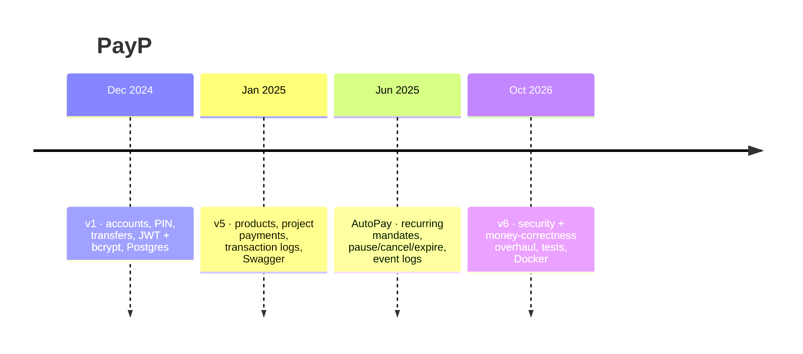
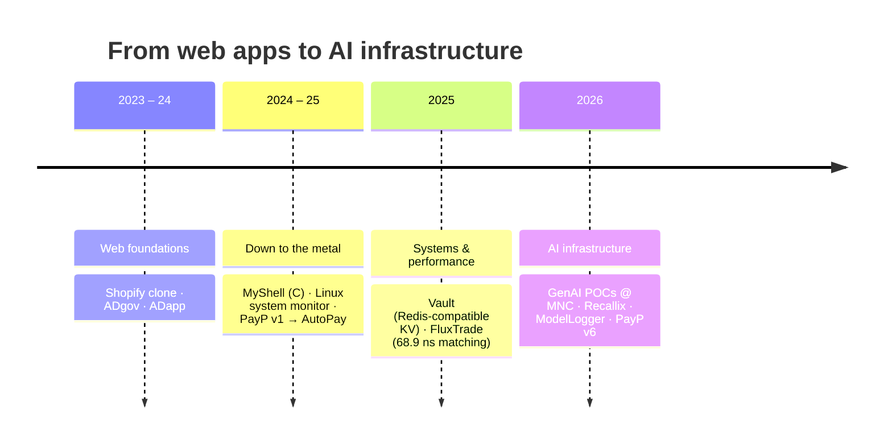

<!-- ═══════════════ HEADER ═══════════════ -->
<p align="center">
  
</p>

<p align="center">
  
</p>

<p align="center">
  <a href="https://ad-folio.vercel.app"></a>
  <a href="https://linkedin.com/in/ayishik-das"></a>
  <a href="mailto:ayishikofficial@gmail.com"></a>
</p>

---

### `$ whoami`

```yaml
name:        Ayishik Das
role:        System Engineer @ MNC  # GenAI POCs for enterprise clients
focus:       [AI agents, LLM infrastructure, RAG systems, backend engineering]
flagship:    PayP  # payments engine, v1 → v6, still evolving
shipped_at_work:
  - 3 GenAI POCs (Claude + Python, integrated with PeopleSoft)
  - ~70% reduction in manual processing
  - 🥈 2nd place, company-wide AI challenge
belief:      "AI is only as good as the backend underneath it"
languages:   [C++20, Python, JavaScript/TypeScript, C, Java]
location:    Kolkata, India 🇮🇳
status:      open_to(["AI infra", "backend", "founding engineer"])
```

---

### 💸 Flagship: [PayP](https://github.com/AyishikD/PayP) — a UPI-style payment platform, built from scratch

> My first serious backend, written by hand before AI tools were part of how I work.
> Two years later I came back, audited it like an attacker, and rebuilt the parts that would have lost real money.

[](https://payp.onrender.com/api-docs/)
[](https://www.postman.com/mission-geologist-4118891/payp/collection/za1hjme/routes-payp)
[](https://medium.com/@ayishikad/payp-revolutionizing-payment-integration-with-custom-api-b63a6a329b97)


<sub>Swagger runs on a free tier — the first load can take ~50s to wake up.</sub>

```text
 client ──► Express ──► rate limiter ──► JWT auth ──► controller
                                                          │
                              verify PIN (bcrypt) ◄───────┤
                                                          ▼
                              ┌──────────────────────────────────────┐
                              │  BEGIN                               │
                              │    SELECT … FOR UPDATE  (row locks)  │
                              │    debit / credit  DECIMAL(14,2)     │
                              │    write transaction log             │
                              │  COMMIT                              │
                              └──────────────────────────────────────┘
                                                          ▲
 cron ──► AutoPay scheduler ──► due mandates ─────────────┘──► mandate events
```

#### 🔓 v6: I attacked my own v1 code

| Bug in my 2024 code | What could go wrong | Fix in v6 |
|---|---|---|
| Money stored as floats | Rounding errors on real balances | `DECIMAL(14,2)` + strict amount validation |
| Two payments at the same time | Race condition → double spend | DB transaction + row-level locks on every balance change |
| PINs stored as plain text | One DB leak exposes every PIN | bcrypt-hashed PINs (existing ones migrated) |
| Any user could read any log | IDOR: see other people's transactions | Ownership checks on logs and mandates |
| JWTs never expired | A stolen token works forever | 1-hour expiry, old tokens rejected |
| Login said "email not found" | Attackers can list who has an account | Generic errors + stricter auth rate limits |
| AutoPay after downtime | Charge a user for every missed cycle at once | Skip missed cycles, log failures, auto-expire mandates |

#### 🗺️ How it grew



---

### 🧬 How I've evolved



---

### ⚡ Other things I've built

| | Project | What it does | Numbers / stack |
|---|---|---|---|
| 🧠 | **[Recallix](https://github.com/AyishikD/Recallix)** | Shared persistent memory for AI agents | **~0.1 ms** search @ 1M nodes · C++ HNSW + Python · [demo](https://recallix.vercel.app) |
| 📊 | **[ModelLogger](https://github.com/AyishikD/xlogger)** | Research memory OS for AI/ML teams: turns experiment activity into a searchable memory graph, with autonomous agents | FastAPI · pgvector · Redis · LiteLLM · [demo](https://xlogger.vercel.app) |
| 📈 | **[FluxTrade](https://github.com/AyishikD/FluxTrade)** | Exchange simulator: order book + matching engine | **68.9 ns**/match · C++20 |
| 🗄️ | **[Vault](https://github.com/AyishikD/vault)** | Redis-compatible versioned KV store | C++ · RESP protocol |
| 🔎 | **[MiniAI](https://github.com/AyishikD/MiniAI)** | Web search → LLM summary → follow-up Q&A | Groq · Llama 3 70B · [demo](https://miniai.streamlit.app) |
| 📦 | **[alldbconnect](https://www.npmjs.com/package/alldbconnect)** | One npm API for many databases | published on npm |

<details>
<summary><b>🕹️ Low-level side quests (click to expand)</b></summary>
<br>

- **[MyShell](https://github.com/AyishikD/myshell)** — Linux shell from scratch in C: pipes, redirection, background jobs, history, tab completion
- **[Crux](https://github.com/AyishikD/crux)** — C command-line tool for Linux
- **Linux system monitor** — reads `/proc` directly, pure C
- **[Shopify clone](https://github.com/AyishikD/shopify)** — full-stack e-commerce platform ⭐ 10 · [demo](https://shopify-silk.vercel.app)

</details>

---

### 🛠️ Arsenal

<p align="center">
  <br>
  <br>
  
</p>

<p align="center"><b>AI / LLM:</b> RAG · HNSW · pgvector · LLM agents · Claude · Llama · prompt engineering</p>

---

### 📡 Live telemetry

<p align="center">
  
  
</p>

<p align="center">
  
</p>

<p align="center">
  <picture>
    <source media="(prefers-color-scheme: dark)" srcset="https://raw.githubusercontent.com/AyishikD/AyishikD/output/github-contribution-grid-snake-dark.svg" />
    
  </picture>
</p>

---

### 🏅 Side achievements
`🥈 MNC-wide AI challenge` · `🥇 CxthSense 2.0` · `🥇 TechQuisitive 5.0` · `⭐⭐⭐⭐⭐ HackerRank C++ & Java` · `🧑‍🏫 Mentor @ GirlScript Summer of Code`

<p align="center">
  
</p>
